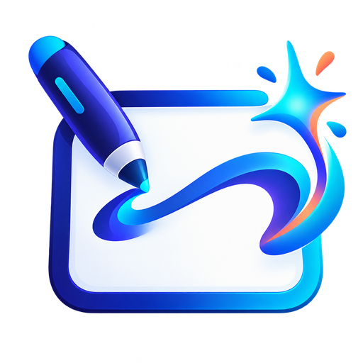

# Inklume ✦ — where ideas take shape

**Inklume** is a free, offline-first Windows whiteboard and infinite creative canvas, built by R3Dzf. Formerly **Bosha Whiteboard**, the v0.3.0 source retains its old internal application ID, Chromium storage profile and `.bosha.json` import compatibility to help protect existing work. Independent of Microsoft.



> **Status: v0.3.0 development / beta source.** Automated Node tests pass; no claim of a verified signed installer or fully functioning delta update is made until a Windows CI build and update between two published NSIS versions succeeds.

## Features

- Infinite canvas, zoom, pan, grid/dots/lines/solid backgrounds, dark canvas, ruler and snap-to-grid.
- Pen, highlighter, touch/pressure sample support, selective ink erasing, lasso, smart **Convert ink to shape** (line, ellipse, rectangle for clear strokes), laser.
- Text, sticky notes, shapes, arrows, images, reactions, alignment, rotation, grouping, layering and undo/redo.
- **PDF import**: converts up to **12 pages / 20 MB** to separate JPEG-backed board objects for markup. PDF contents are **not editable as text**. Requires locally packaged `pdfjs-dist` (no CDN). PDF/PNG/SVG export and editable JSON backups.
- Drag/drop PDFs and images onto the board; paste images from clipboard.
- Six starter layouts for brainstorms, lessons, planning and more.
- Multiple boards with search. In packaged Windows app, each board is saved to its **own atomic JSON snapshot** in userData with a preceding `.bak` recovery copy; IndexedDB is retained for compatibility. Browsers use IndexedDB.
- No account needed, no analytics and no external runtime web service for drawing/storage.
- **Manual, opt-in Windows NSIS updates** via `electron-updater`, with differential-download blockmaps (`differentialPackage: store-asar`) where available; downloadable updates require a later public GitHub Release with `latest.yml` and signed builds are strongly recommended. Portable EXE update behavior not yet verified; use full download for portable. There is **no differential path from v0.2**, which did not include this updater.

## Develop and build

Requires Node.js 22+ and internet access to install dependencies:

```bash
npm install
npm run check
npm start
# On Windows:
npm run dist:win
```

The Windows builder uses `electron-builder` 26 NSIS and portable targets. GitHub Actions builds unsigned development EXEs and uploads build artifacts; successful compilation is not the same as code signing or real-device smoke testing.

Run `npm run check` to exercise the independent board model, PDF writer, native snapshot recovery, update state machine and ink recognition. For interactive hardware and actual import/update verification, use the Windows installer and a 2-version release feed.

### Updating safely

1. Install v0.3.0 or newer **NSIS setup** once. Earlier v0.2.0 cannot update itself automatically; installing v0.3 is a manual upgrade.
2. When the next public GitHub Release includes `latest.yml`, click **Updates → Check for updates**.
3. Confirm download and then restart/install. Updater uses byte-range differential downloading only when compatible blockmaps and host range requests exist; otherwise it can download the full installer.
4. Never delete your `Bosha Whiteboard` data directory without exporting a backup. Updater is optional and does not silently install.

**Security / shipping gate:** Sign production Windows binaries, publish the matching hashes and update manifests, test a change between two released versions, and test fallback before calling it a production-ready updater. The application never ships repository tokens to end-users.

### Storage compatibility

Old IndexedDB database name and the Windows userData path `Bosha Whiteboard` are intentionally preserved even though the new trade name is Inklume. Existing `.bosha.json` files remain importable; new exports are named `.inklume.json` with a compatible data schema. Keep backups before uninstall or clearing application data.

## Keyboard shortcuts

`V` select, `Q` lasso, `H` pan, `P` pen, `M` highlighter, `E` eraser, `N` note, `T` text, `U` ruler, `B` double arrow. `Ctrl+Z/Y` undo/redo, `Ctrl+G / Ctrl+Shift+G` group/ungroup, `Ctrl+C/V` copy/paste objects; clipboard images paste directly. `Ctrl+S` saves a `.inklume.json` editable copy.

See [FEATURES.md](FEATURES.md) for the honest full Microsoft Whiteboard comparison and remaining roadmap. Microsoft `.whiteboard` and native PowerPoint imports, true co-editing, Android and signed production releases are **not implemented**.

MIT licensed. © R3Dzf contributors.
